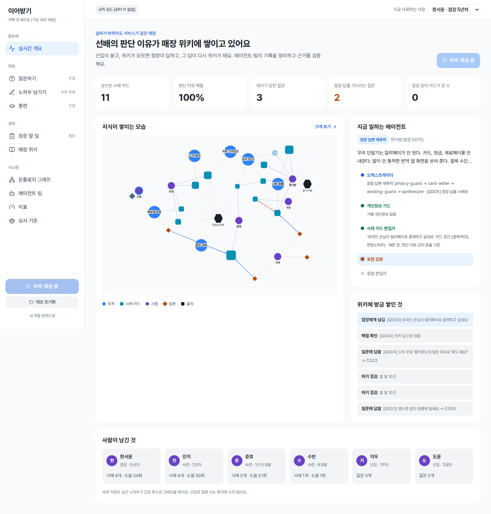
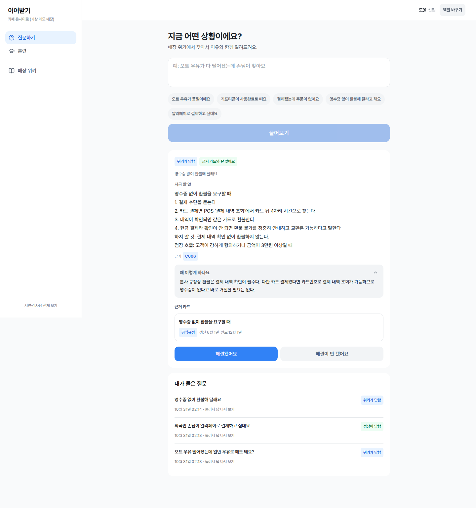
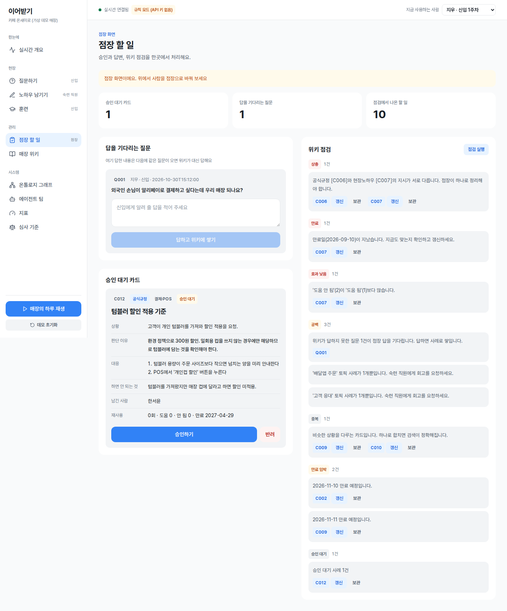

# 이어받기

이어받기는 선배의 예외 대응 이유와 점장의 답을 매장 위키에 쌓아, 신입도 근거를 보고 일하도록 돕는 AI 서비스다.

2026 한국지식경영학회 추계학술대회 「대학생 AI 시대 스마트서비스 아이디어 공모전」 출품작.

## 대표 화면

매장 위키와 에이전트 실행이 함께 바뀌는 화면.



신입이 대응 방법과 근거를 확인하는 화면.



점장이 질문에 답하고 사례를 검토하는 화면.



## 무엇을 해결하나

쿠폰 오류, 품절, 교환·환불처럼 매뉴얼만으로 판단하기 어려운 순간이 있다. 신입은 무엇부터 확인할지 모르고, 점장은 같은 맥락을 다시 설명한다. 이어받기는 숙련 직원이 무엇을 했고 왜 그렇게 판단했는지 남긴다. 다음 직원은 사례의 조건과 근거를 보고 대응한다.

모르는 질문은 점장에게 넘긴다. 점장이 남긴 결정과 이유는 새 사례가 되어 다음 질문의 근거로 쓰인다. 반복 설명을 줄이려는 설계지만 기록과 검수도 사람의 일이다. 실제로 노동시간이 줄었는지, 독립 매장에서 운영할 만한지는 아직 확인하지 않았다. 문제의 빈도와 효과를 확인할 계획은 [차별화 전략](docs/strategy/차별화_전략.md)에 적었다.

## 어떻게 동작하나

숙련 직원이 사건을 기록하면 개인정보를 가리고, 회고 인터뷰어가 빠진 판단 이유와 금지 조건을 되묻는다. 사례 초안은 점장 승인 후 위키에 쓰인다. 신입의 질문에는 승인된 사례를 검색해 답하고, 검증팀이 인용·규정 우선·표현을 확인한다. 근거가 없거나 점장 호출 기준에 해당하면 점장에게 넘긴다. 점장의 답은 다시 카드로 쌓이고 토픽 원칙도 갱신된다. 실행 이벤트는 SSE로 화면에 전달되고 활동 피드와 지식그래프에 반영된다.

아래 팀·에이전트·역할·LLM 구분은 [하네스 선언](harness/harness.config.json)을 그대로 옮겼다. LLM으로 표시한 에이전트도 API 키가 없거나 호출이 실패하면 규칙으로 결과를 만든다. 위키 점검관은 의미상 상충에 LLM을 쓰고, 만료·중복 등의 점검에는 규칙도 쓴다.

| 팀 | 에이전트 | 하는 일 | LLM/규칙 |
|---|---|---|---|
| 지휘 | 오케스트레이터 | 들어온 요청을 흐름(질문·기록·점장 답변·점검·훈련)에 배정하고 실행 순서와 결과 요약을 맡는다 | 규칙 |
| 수집팀 | 개인정보 가드 | 기록 속 전화번호·카드번호·고객 실명을 가린다. 가린 개수를 남긴다 | 규칙 |
| 수집팀 | 회고 인터뷰어 | 무엇을 했는지만 적힌 기록에서 빠진 판단 이유·하면 안 되는 것·점장 호출 기준을 되묻는다 | LLM |
| 수집팀 | 사례 카드 편집자 | 기록과 되묻기 답을 상황·판단 이유·대응·금지·호출 기준의 사례 카드로 정리한다 | LLM |
| 답변팀 | 검색 사서 | 승인된 사례 카드에서 질문과 가까운 카드를 찾는다(한국어 2-gram BM25) | 규칙 |
| 답변팀 | 현장 코치 | 찾은 카드만 근거로 신입이 바로 따라 할 답을 쓴다. 문장마다 카드 번호를 붙인다 | LLM |
| 답변팀 | 점장 연결 | 근거가 없거나 점장 호출 기준에 걸리면 점장에게 넘긴다 | 규칙 |
| 검증팀 | 근거 검증 | 답의 문장마다 실제 승인된 카드 번호가 붙었는지, 없는 카드를 인용하지 않았는지 본다 | 규칙 |
| 검증팀 | 규정 우선 검증 | 인용한 카드끼리 공식규정과 현장노하우가 부딪히면 공식규정을 따르라는 안내가 있는지 본다 | 규칙 |
| 검증팀 | 표현 검증 | 고객 탓, 단정, 임의 보상 약속 같은 금지 표현을 막는다 | 규칙 |
| 위키 관리팀 | 종합 편집자 | 토픽에 카드가 늘거나 바뀌면 토픽 페이지의 핵심 판단 원칙을 다시 쓴다 | LLM |
| 위키 관리팀 | 위키 점검관 | 상충·만료·효과 낮음·중복·빈 토픽·승인 대기를 찾아 점장 할 일로 만든다 | LLM |
| 위키 관리팀 | 훈련 코치 | 실제 사례의 상황만 보여 주고 신입의 답을 카드와 비교해 피드백한다 | LLM |

## 기존 서비스와 다른 점

직원용 챗봇과 AI 문서 작성은 이미 있다. 이어받기는 사건을 회고하며 판단 이유를 모으고 점장이 해결한 질문까지 다음 직원의 근거로 남긴다. 이 흐름이 기존 서비스와 어떤 차이를 만드는지 검증하려 한다.

| 비교 항목 | 본사 FAQ 챗봇 | SOP 매뉴얼 도구 | 사내위키 | 이어받기 |
|---|---|---|---|---|
| 지식의 출발점 | 본사 FAQ·공지·업무 자료, 일부 점포 문의 | 관리자 작성 절차와 AI 초안 | 구성원이 작성·공유한 문서 | 숙련자의 사건 회고·매장 규정·점장 답 |
| 판단 이유 수집 | 회고 인터뷰 여부 미확인 | 사건별 후속 질문 미확인 | 작성자와 운영 방식에 달림 | 이유·금지 조건·호출 기준을 되묻고 확인 |
| 해결 결과의 재축적 | 점장 답의 사례 전환 미확인 | 결정 기록은 가능, 자동 환류 미확인 | 직접 기록하거나 업무 흐름 연결 | 점장 답을 사례로 저장하고 재검색 |
| 독립 매장 이용 | 조사 사례는 해당 브랜드 내부용 | 사용 가능 | 별도 운영 가능, 제품별 조건 미조사 | 본사 시스템 없이 시작하도록 설계 |

이 표는 [전략 문서의 비교표](docs/strategy/차별화_전략.md)를 요약했다. 본사 챗봇 사례는 GS25와 스타벅스의 당시 보도에 근거한 부분검증이다. SOP 사례는 Trainual·모두의매뉴얼이다. 경쟁 제품의 현재 전체 기능은 조사하지 않았다. ‘미확인’은 기능이 없다는 뜻이 아니며, 특정 위키 제품보다 우월하다고 확인한 것도 아니다.

## 실행 방법

Node.js 22 이상이 필요하다. 저장소 루트에서 터미널을 열고 백엔드를 시작한다.

```bash
cd backend
npm install
npm start
```

백엔드는 기본 `http://localhost:8787`에서 실행된다. `ANTHROPIC_API_KEY`가 실행 환경에 있으면 Claude(`claude-opus-5-5`)를 호출한다. 키가 없으면 규칙 모드로 동작하고 호출에 실패해도 규칙으로 대체한다. 어떤 모드인지는 화면과 실행 기록에서 확인할 수 있다. 모델은 `CLAUDE_MODEL` 환경변수로 바꿀 수 있다.

API 키 없이 매장 PC의 로컬 모델로 돌리려면 [Ollama](https://ollama.com)를 켜 두고 다음처럼 시작한다. 기본 모델은 SK텔레콤의 한국어 모델 A.X 4.0 Light(`ax4-light:q4_K_M`)이고 `OLLAMA_MODEL`로 바꿀 수 있다. 직원 기록이 매장 밖으로 나가지 않는다.

```bash
LLM_PROVIDER=ollama OLLAMA_HOST=http://localhost:11434 npm start
```

WSL에서 Windows에 설치한 Ollama를 쓰면 `OLLAMA_HOST`에 Windows 쪽 주소(`ip route`의 default 게이트웨이, 예: `http://172.20.32.1:11434`)를 넣는다. RTX 2080 SUPER(8GB)에서 호출 한 번에 40초 안팎 걸렸다. 다른 프로그램이 GPU를 같이 쓰면 더 느려진다.

다른 터미널에서 프론트엔드를 시작한다.

```bash
cd frontend
npm install
npm run dev
```

`http://localhost:5173`에 접속한다. Vite가 `/api` 요청을 `http://localhost:8787`로 프록시한다. 처음 화면에서 사용할 역할을 고른다. 전체 흐름을 보려면 **시연·심사용 전체 보기**에서 **매장의 하루 재생**을 실행한다. 질문 → 점장 답 → 새 카드 → 재질문과 기록·승인·점검이 이어진다. 가상 매장 데이터로 실행하면 위키 상태가 바뀐다.

### 가상 손님

시연 모드의 **가상 손님** 화면에서 손님을 들여보낼 수 있다. 손님은 NVIDIA의 [Nemotron-Personas-Korea](https://huggingface.co/datasets/nvidia/Nemotron-Personas-Korea)(CC BY 4.0)에서 뽑는다. 통계청 인구 분포를 바탕으로 만든 한국인 합성 인물 100만 명이고, 이 중 120명을 `data/personas/`에 받아 두었다. 로컬 AI가 손님의 나이·직업·식습관에 맞춰 계산대 예외 상황과 손님 말을 만들고, 그 손님을 맞은 신입의 질문이 실제 질문 흐름에 들어간다. 위키가 답하지 못해 점장에게 넘어간 질문은 숙련 직원에게 먼저 받아 둘 노하우 목록이 된다.

```bash
cd backend
npx tsx scripts/fetch_personas.ts 120          # 페르소나 다시 받기
LLM_PROVIDER=ollama OLLAMA_HOST=... npx tsx scripts/simulate_customers.ts 20   # → docs/judge/persona_sim.md
```

합성 인물이 만든 상황이라 실제 매장 질문의 빈도를 대신하지 못한다. 실제 질문 로그를 모으기 전에 위키의 빈틈을 미리 찾는 용도로만 쓴다.

백엔드 테스트와 프론트엔드 빌드는 각 폴더에서 실행한다.

```bash
# backend/
npm test

# frontend/
npm run build
```

회고 인터뷰와 카드 구조화 비교 스크립트는 [backend/scripts/compare_modes.ts](backend/scripts/compare_modes.ts)다. 백엔드 폴더에서 아래 명령을 실행한다.

```bash
npx tsx scripts/compare_modes.ts
```

실행 환경에 API 키가 있으면 같은 기록을 규칙·LLM 모드로 비교한다. 결과는 [docs/judge/llm_vs_rules.md](docs/judge/llm_vs_rules.md)에 덮어쓴다. 현재 저장된 결과에서 LLM 열은 API 키가 없어 실행하지 않은 상태다.

## 폴더 구조

하네스 선언, 실행 코드, 화면, 지식 저장을 나눴다. 자세한 흐름과 API는 [설계 문서](docs/ARCHITECTURE.md)에 있다.

| 경로 | 내용 |
|---|---|
| `harness/` | 팀·에이전트·흐름·게이트·모델 선언, 에이전트 카드 참조 위치, 금지 표현·개인정보 정책 |
| `shared/contracts.ts` | 백엔드·프론트 공통 타입: 카드·질문·실행 이벤트·그래프 |
| `backend/src/harness/` | 선언 읽기, 흐름 실행, 실행 버스, Claude 호출 |
| `backend/src/agents/` | 수집·답변·검증·위키 관리 에이전트 |
| `backend/src/flows/` | 질문·기록·승인·점장 답 재축적·점검·훈련 흐름 |
| `backend/src/store/` | JSON 저장, 마크다운 위키 컴파일, 지식그래프 |
| `backend/src/tools/` | 한국어 2-gram BM25 검색, 표현·개인정보 규칙 |
| `frontend/src/features/` | 개요·질문·기록·훈련·점장·위키·그래프·에이전트·지표·심사 화면 |
| `frontend/src/shared/` | API·SSE 상태, 공통 UI, 색 토큰 |
| `data/` | 가상 매장 시드와 자동 컴파일되는 마크다운 위키 |
| `docs/` | 설계·전략·참고 자료·심사·화면 캡처 |
| `.orchestra/` | 개발 오케스트라 구성·작업 지시문·실행 로그 |

[개발 오케스트라](.orchestra/team.json)의 팀장은 Claude Opus 5.5와 GPT-6 Astra, 작업자는 Claude Sonnet 5.5와 GPT-6.1 Sol이다. 코드는 Claude가, 사람이 읽는 글은 GPT가 맡는다. 개발팀 구성과 제품 안에서 동작하는 `harness/`의 에이전트 팀은 별개다.

## 개발 중 심사

공모전의 문제 정의 및 필요성, AI 디지털 기술 활용성, 창의성 및 차별성, 비즈니스 서비스 타당성, 기술 현실적 실현 가능성을 각 20점으로 평가했다. 아래는 [scores.json](docs/judge/scores.json)에 기록한 개발 중 내부 심사 결과로, 공모전 공식 점수가 아니다.

| 라운드 | 심사위원 | 합계 /100 |
|---|---|---:|
| 1차 중간 심사 | Claude Opus 5.5 | 68 |
| 1차 중간 심사 | GPT-6 Astra | 70 |
| 2차 심사 | Claude Opus 5.5 | 70 |
| 2차 심사 | GPT-6 Astra | 72 |
| 3차(최종) 심사 | Claude Opus 5.5 | 70 |
| 3차(최종) 심사 | GPT-6 Astra | 73 |

합계는 공모전 기준 5개 항목만 더한 값이다. 별도 사용성·하네스 점수는 제외했다. 각 점수는 해당 라운드의 수정 전 평가다. 3차 심사는 2차 수정을 반영한 상태에서 진행했다. 아래 3차 수정 뒤에는 재평가한 점수가 없다.

1차 뒤에는 만료·상충 근거를 제외하고, 허위 인용·금지 표현 줄 삭제와 점장 이관을 보강했다. 개인정보 가림과 승인 시 표현 재검사를 추가하고, 역할별 메뉴·기록 임시 저장·근거 표시·점장 검토 화면·지표를 고쳤다. 규칙·LLM 비교 스크립트도 만들었다. 테스트는 15개에서 23개로 늘었다.

2차 뒤에는 무인용 ‘공식규정’ 문장의 검증 예외를 없애고, 금액 비교·안전 어휘 이관·승인 대기 점장 답의 노출 차단·규칙 모드 금지 분류를 고쳤다. 질문자를 역할 묶음으로 표시하고 개인별 질문 수를 없앴으며, 비공개 크레딧·조용한 점검·한국어 에이전트 이름·질문과 훈련 안내·공식규정 보관 확인을 반영했다. 테스트는 23개에서 28개로 늘었지만 LLM 품질·현장 효과·지불 의향은 여전히 측정하지 않았다.

3차 뒤에는 신입에게 답을 보내기 직전 금지 표현 줄과 이유를 다시 검사하는 최종 출력 관문을 넣었고, 수정 승인한 점장 답은 승인된 카드로 다시 만들어 보여 준다. 안전 이관 답에서 매장 사례 행동을 빼고 안전 어휘를 보강했으며, 비공개 크레딧을 변경 기록·마크다운 위키·카드 상세에도 적용했다. 보관 사유를 서버에 저장하고 ‘규정 원문 미첨부’를 표시하며, 화면을 다시 캡처하고 테스트를 31개로 늘렸다.

## 검증한 것 / 한계

[설계 문서](docs/ARCHITECTURE.md)에 남은 검증 기록과 현재 한계를 구분했다. 이 README를 작성하면서 테스트나 시연을 다시 실행하지 않았다.

| 남아 있는 검증 기록 | 확인한 범위 |
|---|---|
| 백엔드 `npm test` | 규칙 모드 테스트 31개. 검색·검증·재축적·회고·점검과 무인용 공식규정 문장 제거, 금액 비교, 바꿔 말한 안전 상황 이관, 승인 후 질문 종료, 금지 분류를 다룬다. 이번 문서 작업에서는 재실행하지 않았다 |
| 프론트엔드 `npm run build` 및 Playwright 캡처 | 빌드 통과, 화면의 콘솔 오류·가로 넘침 없음, 하루 재생 중 실시간 반영 확인 |
| [시연 실행 기록](docs/judge/demo_run.md) | 규칙 모드에서 점장 답으로 새 카드가 생긴 뒤 재질문의 근거로 사용됨. 호출 기준 질문의 점장 이관도 기록 |
| [회고 모드 비교 기록](docs/judge/llm_vs_rules.md) | 규칙 모드 출력만 기록. LLM 열은 미실행 |

현재 데모는 만료·상충 근거 제외, 무인용·허위 인용·금지 표현 줄 삭제, 숫자에 따른 금액 호출 판정, 개인정보 패턴 가림을 지원한다. 안전 어휘 목록에 걸린 질문에는 위키가 답하지 않는다. 점장에게 넘기고 119/112를 안내한다. 목록에 없는 표현은 놓칠 수 있다. 금지 표현으로 승인 대기가 된 점장 답은 신입에게 보이지 않으며 카드 승인 때 질문이 닫힌다. 다만 유효한 카드를 인용했다고 해서 문장이 카드 뜻과 맞거나 내용이 사실이라고 보장할 수는 없다. 공식규정의 원문·버전도 확인하지 않는다. 개인정보 가림은 모든 식별정보를 탐지하지 못한다. 비슷한 대기 질문을 자동으로 해결할 때 조건이 다른 질문까지 처리하는지는 따로 검증해야 한다.

데모 매장과 사례는 가상이다. 실제 매장의 시간 절감이나 응대 개선은 측정하지 않았다. LLM 모드의 품질·비용과 규칙 모드 대비 차이도 측정하지 않았다. 규칙 모드의 회고·구조화는 문장 단위 휴리스틱이고, 한국어 검색은 형태소 분석 없이 2-gram을 써 동의어를 일부 놓친다. 그래프 시각화가 검색 정확도를 높였다는 근거도 없다.

그래프의 질문자는 역할 묶음으로만 표시한다. 개요와 위키 사람 페이지에는 개인별 질문 수를 표시하지 않고, 크레딧을 끈 카드는 ‘이름 비공개’로 연결한다. 다만 ‘내가 물은 질문’을 보여 주려고 질문 기록에 `askerId`를 저장한다. 계정·권한이 없어 접근 통제 없이 역할 선택으로 시연한다. 승인자가 실제 점장인지도 확인할 수 없다. 실제 배포 전에는 로그인과 서버 권한 검사, 매장별 데이터 분리, 공식규정 원문·확인자 관리, 보관·삭제 기간과 모델 호출 로그 정책이 필요하다. 근무 중 기록과 평가 목적 사용 금지는 운영에서 확인해야 한다. 임시 저장과 크레딧 선택만으로 기록 부담이 해결됐다고 볼 수 없다.

## 참고한 것

[참고 저장소의 채택 결정](docs/references/repos.md)에서 우선순위가 높은 항목을 정리했다. 설계에 참고한 원칙과 실제 설치한 라이브러리는 구분한다.

| 참고 자료 | 가져온 점 |
|---|---|
| [Cytoscape.js](https://github.com/cytoscape/cytoscape.js) | 지식그래프의 타입별 표현과 노드 증분 추가 |
| [토스 라이팅 원칙](https://toss.tech/article/8-writing-principles-of-toss), [TDS 컬러 시스템](https://toss.tech/article/tds-color-system-update) | 짧고 행동을 알 수 있는 문구, 의미별 색 토큰. UI 키트 복제는 하지 않음 |
| [Value first, Cost later](https://toss.tech/article/value-first-cost-later), [Easy to answer](https://toss.tech/article/insurance-claim-process) | 기록의 쓰임을 먼저 설명하고 답하기 쉬운 질문으로 나누기 |
| [OpenAI Agents SDK Tracing](https://openai.github.io/openai-agents-python/tracing/), [AG-UI](https://github.com/ag-ui-protocol/ag-ui) | 에이전트 실행·이관·검증 이벤트의 구분 참고 |
| [LangGraph](https://github.com/langchain-ai/langgraph) | 실행 타임라인과 사람이 개입하는 승인 대기 패턴 |
| [KCS v6](https://library.serviceinnovation.org/KCS/KCS_v6/KCS_v6_Practices_Guide), [LLM Wiki 구현 참고](https://github.com/Astro-Han/karpathy-llm-wiki) | 업무 중 지식 수집·재사용·개선, ingest·query·lint 흐름. Karpathy 원문 링크는 참고 문서에서도 미검증 |
| [Recharts](https://github.com/recharts/recharts), [Pretendard](https://github.com/orioncactus/pretendard) | 지표 차트와 한글 서체 |

[수상작 조사](docs/references/winners.md)에서는 구체적인 사용자와 문제, 데이터 출처 공개, 작동하는 시연, 역할별 에이전트와 사람 이관, 이야기와 시각화라는 패턴을 참고했다. [Microsoft AI Agents Hackathon](https://microsoft.github.io/AI_Agents_Hackathon/winners/)의 Konveyor는 지식 이전, Bit2Brain은 지식 지도, [Cornell Hospitality Hackathon](https://business.cornell.edu/hub/2024/10/02/hospitality-hackathon-embraces-ai-improve-guest-experience)은 처리 한도를 넘으면 직원에게 넘기는 사례다. [ODSC 수상자 인터뷰](https://opendatascience.com/insights-from-the-winners-of-the-2025-odsc-google-cloud-hackathon/)의 문제 중심 설명과 짧은 시연도 참고했다. 수상 사실이 이어받기의 효과를 입증하지는 않는다. 조사 문서에서 미검증으로 남은 성과 수치는 효과 근거로 쓰지 않았다.
